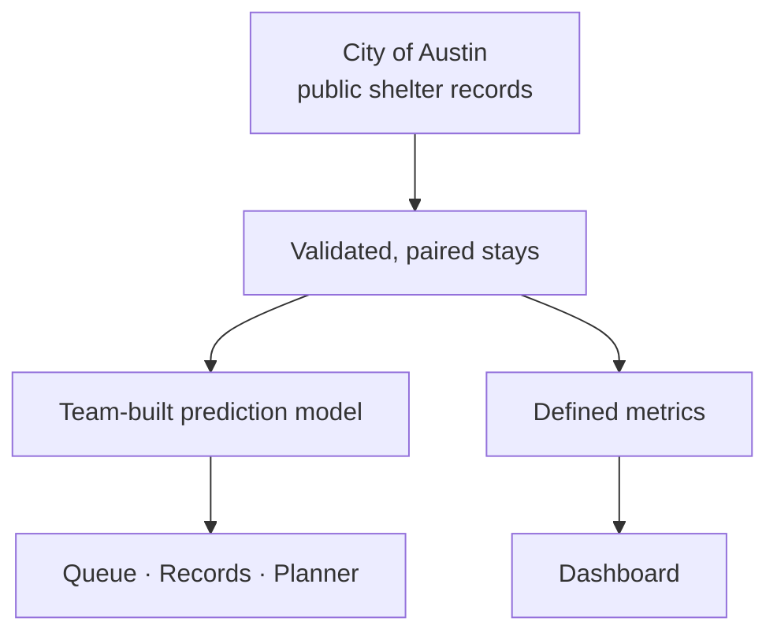

  

<h1 align="center">SecondChance</h1>

<strong>A predictive-analytics platform that turns animal long-stay risk into earlier, more focused shelter support.</strong>

  &nbsp;
  &nbsp;
  

Live · UNC Charlotte team project · Website by Davis Higgins

---

## See it in motion

  

Real capture of secondc.vercel.app/queue using the City of Austin's public shelter records. <a href="assets/demo.png">Static frame</a>

## What it does

- **A support queue that leads with the wait.** Open stays are ranked by their likelihood of a long stay, with actual days waiting beside each one, and filters for species, life stage, and wait time.
- **Records with their context.** Each animal's page shows the stay timeline, what was known at intake, and a suggested kind of support.
- **A weekly outreach planner.** Staff set their capacity, choose actions, and export or print a plan for the week.

## Why it exists

Shelters make time-sensitive decisions with limited staff, foster homes, and hours in the day. The people doing the work know why some animals wait longer, but reviewing every case at the right moment is hard.

The project has one rule, and it appears on every operational page: **a high predicted long-stay risk is a request for more help, not less.** Scores route photography, profile improvements, foster recruitment, and outreach toward animals who need it.

## My contribution

SecondChance is a four-person UNC Charlotte predictive analytics project built with Bennett Shearin, Seth Sumter, and Hunter Pace. The research and modeling were shared team work. My part:

- Designing and building the web application: dashboard, support queue, record browser, outreach planner, impact page, and methodology pages
- Presenting the team's work clearly, with observed outcomes, predictions, and planning assumptions kept visibly separate
- The project's presentation

<strong>How it's put together</strong>

 

| Decision | Why |
|---|---|
| **Predictions made at intake** | Estimates use only what was known when an animal arrived, so they reflect a real decision point. |
| **Every metric defined once** | Each figure has one definition used everywhere it appears, so the dashboard, records, and glossary always agree. |
| **Fresh data, clearly dated** | The site tracks when the source data was last updated and says so when the feed runs late. |

## Screens

<table>
  <tr>
    <td width="62%"></td>
    <td rowspan="2" width="38%" align="center"></td>
  </tr>
  <tr>
    <td></td>
  </tr>
</table>

Shelter overview · The data and predictions, in plain language · Support queue on mobile

## Technology

| Layer | Technology |
|---|---|
| Web app | Next.js, React, TypeScript, Tailwind CSS |
| Modeling | Python |
| Motion | GSAP, Lenis |
| Hosting | Vercel |

---

  &nbsp;
  

© 2026 Davis Higgins. Shelter data: City of Austin Open Data Portal.

