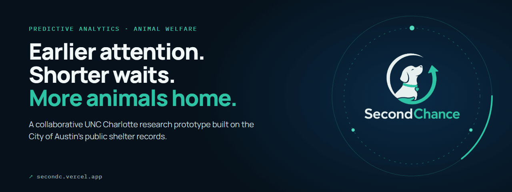
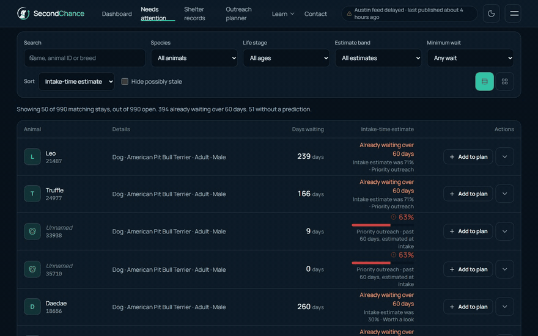
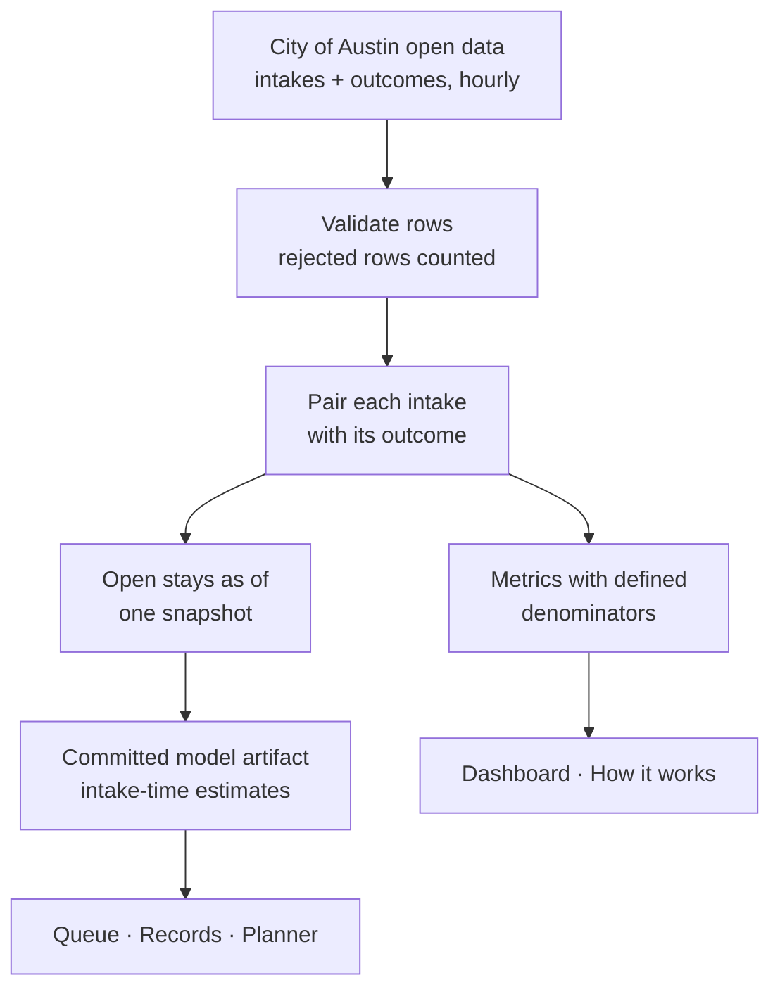
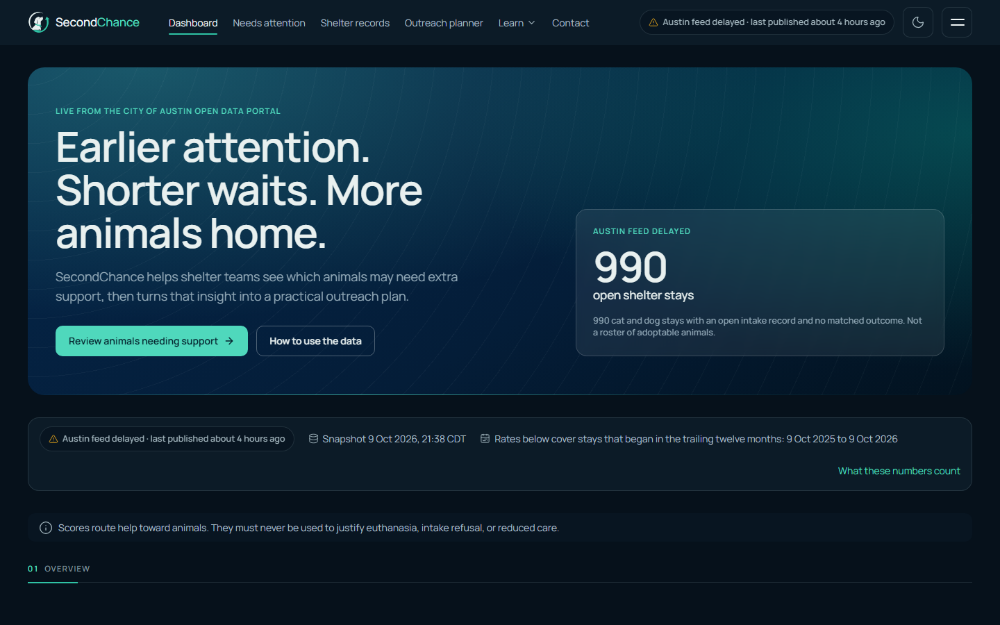
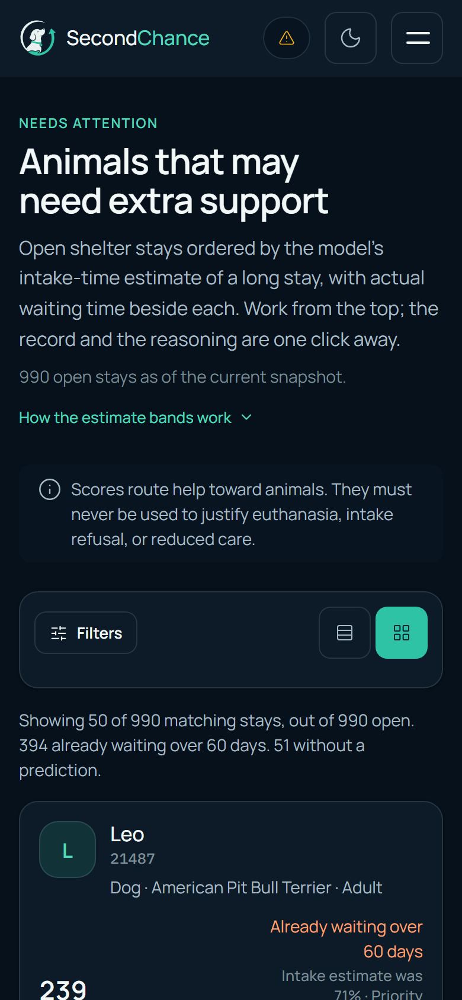
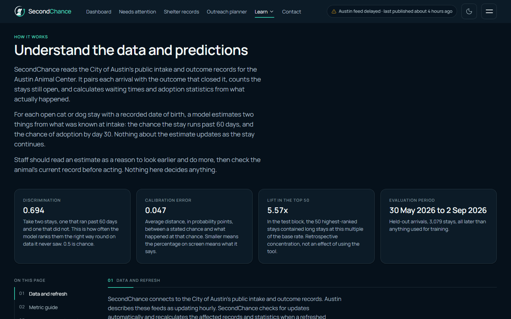

  

<h1 align="center">SecondChance</h1>

  <strong>A collaborative predictive-analytics prototype that turns animal long-stay risk into earlier, more focused shelter support.</strong> 
  <a href="https://secondc.vercel.app"><strong>Open SecondChance ↗</strong></a> · <a href="https://secondc.vercel.app/model">How it works</a> · <a href="https://www.higginsd.com/work/secondchance">Case study</a> · <a href="https://davishiggins.com">Davis Higgins</a>

Live research prototype · UNC Charlotte team project (DTSC 3601) · Not affiliated with Austin Animal Center

> **Team:** Davis Higgins, Bennett Shearin, Seth Sumter, and Hunter Pace. I was responsible for the website and the project's presentation. The research, data analysis, and modeling were team work.

---

## See it in motion

  

Real capture of secondc.vercel.app/queue using the City of Austin's public shelter records. <a href="assets/demo.png">Static frame</a>

## What it does

- **A support queue that leads with the wait.** Open stays are ranked by an intake-time estimate of a long stay, with actual days waiting beside each one. Filters cover species, life stage, estimate band, and minimum wait.
- **Records with their context.** Each animal's page shows the stay timeline, what was recorded at intake, the estimate and when it was made, data-quality notes, and a suggested kind of support.
- **A weekly outreach planner.** Staff set capacity, choose actions, and export a plan to CSV or print. Every planning assumption is written down, and projected benefits are never presented as measured results.

## Why it exists

Shelters make time-sensitive decisions with limited staff, foster homes, and hours in the day. The people doing the work know why some animals wait longer, but reviewing every case at the right moment is hard. Public intake and outcome records hold useful patterns, but they need careful interpretation before they can support a decision.

The project has one rule, and it ships on every operational page: **a high predicted long-stay risk is a request for more help, not less.** Scores route photography, profile improvements, foster recruitment, and outreach toward animals. They must never justify reduced care, intake refusal, or euthanasia.

## My contribution

SecondChance began as a four-person UNC Charlotte predictive analytics project. My part:

- Designing and building the web application: dashboard, support queue, record browser, outreach planner, impact page, and methodology pages
- Presenting the team's model and data honestly, with observed outcomes, intake-time estimates, and planning assumptions kept visibly separate
- The project's presentation

The archive research, analysis, and model development were shared across the team. I don't claim sole ownership of the model or the project.

## How it works

### Engineering decisions

| Decision | Why |
|---|---|
| **Estimates are answered at intake** | Both predictions (a stay past 60 days, adoption by day 30) use only what was known when the animal arrived. If an animal is already past 60 days, the site leads with that fact and keeps the estimate as context. |
| **Every metric defined once** | A single metric registry defines each figure's meaning, unit, formula, window, sample, and limits. It feeds the tiles, charts, record pages, and glossary, so "adopted within 30 days" always divides by arrivals that have actually had 30 days. |
| **Freshness kept honest** | The site tracks separate clocks for the publisher's last update, the newest record, its own retrieval, and the snapshot. It shows a delay banner when Austin's feed is late, and an open intake record is never presented as confirmation that an animal is available. |

The public record browser receives a data shape with no field that could carry a score, so predictions can't leak into the public view by accident.

## Screens

<table>
  <tr>
    <td width="62%"></td>
    <td rowspan="2" width="38%" align="center"></td>
  </tr>
  <tr>
    <td></td>
  </tr>
</table>

Shelter overview · How it works: model evaluation in plain language · Support queue on mobile

## Technology

| Layer | Technology | Responsibility |
|---|---|---|
| Web app | Next.js 15 (App Router), React 19, TypeScript, Tailwind CSS v4 | Dashboard, queue, records, planner, methodology |
| Data | City of Austin Socrata API, zod | Reading and validating live intake and outcome feeds |
| Modeling | Python, LightGBM, isotonic calibration | Team-built classifiers exported as a committed artifact |
| Motion | GSAP, Lenis | Section reveals and smooth scrolling, with reduced-motion support |
| Hosting | Vercel | Deployment |

## Evaluation and limits

<strong>How the current model was evaluated</strong>

 

Two LightGBM classifiers were trained on completed stays from the current feeds, calibrated with isotonic regression on a later validation block, and tested on a still-later held-out block. The site reads every metric from the committed model artifact rather than hand-typed values.

| Target | Held-out stays | ROC AUC | Calibration error | Lift in top 50 |
|---|---|---|---|---|
| Stay past 60 days | 3,079 | 0.694 | 0.047 | 5.57× |
| Adopted by day 30 | 3,217 | 0.803 | 0.062 | 2.39× |

The project also includes a study of Austin's 2013–2022 archive. That archive model isn't the one scoring the site, because Austin's source system and IDs changed in May 2025. The repository's test suites cover episode pairing, model parity between Python and TypeScript, time handling, metric denominators, and planner math.

- **A prototype, not a deployment.** SecondChance is a student research prototype built from public data. No shelter uses it operationally.
- **Finding isn't helping.** The queue identifies animals who may wait longer. Nobody has shown yet that acting on it changes outcomes; that would need a prospective study.
- **One shelter, one city.** The workflow transfers, but the model should be retrained and re-evaluated before use anywhere else.
- **Known data issue.** Some records with an intake condition of "Dead" remain in the current evaluation set. The methodology page discloses this.

## About this repository

This is a documentation-only showcase. The application, research code, data, and model artifacts aren't included here.

**[Open SecondChance ↗](https://secondc.vercel.app)** · Website by [Davis Higgins](https://davishiggins.com) · [More of my work](https://github.com/DavisHiggins)

© 2026 Davis Higgins. Text and images in this repository are shared for portfolio viewing. SecondChance was built by Davis Higgins, Bennett Shearin, Seth Sumter, and Hunter Pace. Shelter data: City of Austin Open Data Portal (public domain). Not affiliated with the Austin Animal Center.
